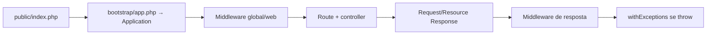

# Arquitetura e ciclo de vida — Laravel 13.x

> **Versão:** Laravel 13.x · PHP 8.3–8.5. `bootstrap/app.php` é o ponto de composição;
> não existem `Http/Kernel.php`, `Console/Kernel.php` nem `Exceptions/Handler.php`.

---

## 1. `bootstrap/app.php` — o centro de configuração

O skeleton 13 configura três dimensões (`samples/samples-bootstrap-app.php:8-21`):

```
Application::configure(...)
 ├─ withRouting(web, commands, health)
 ├─ withMiddleware(fn (Middleware $m))
 └─ withExceptions(fn (Exceptions $e))
                    → create()
```

samples/samples-bootstrap-app.php:8-21
```php
return Application::configure(basePath: dirname(__DIR__))
    ->withRouting(
        web: __DIR__.'/../routes/web.php',
        commands: __DIR__.'/../routes/console.php',
        health: '/up',
    )
    ->withMiddleware(function (Middleware $middleware): void {
        //
    })
    ->withExceptions(function (Exceptions $exceptions): void {
        $exceptions->shouldRenderJsonWhen(
            fn (Request $request) => $request->is('api', 'api/*') || $request->expectsJson(),
        );
    })->create();
```

> Pontos de extensão derivados da API: `withProviders`, `withEvents`, `withSchedule`
> e `preventRequestForgery(...)`. O bloco acima é o arquivo literal do skeleton,
> verificado byte a byte por `verify.py`.

Métodos adicionais disponíveis: `withProviders`, `withEvents`, `withSchedule`.
`withScheduling()` teve o registro diferido até `Schedule` ser resolvido no 13
(`samples/doc-upgrade-13.md:381-391`) — não conte com execução imediata no bootstrap.

---

## 2. Container, DI e atributos

O service container continua sendo a base: bindings em providers, resolução por tipo,
`singleton` quando o estado é realmente compartilhado e `scoped` para estado por
request/job. Em Octane, `scoped` é a escolha segura para anything mutável
(`samples/doc-octane.md:438-572`).

Atributos de container (`#[Bind]`, `#[Singleton]`, `#[Scoped]`, `#[CurrentUser]`,
`#[Context]`, `#[DB]`, `#[Cache]`, `#[Config]`) permitem declarar dependências junto da
classe. No 13, a lista de atributos first-party se expande para controllers,
autorização, filas, Eloquent, eventos, notificações, validação e testes
(`samples/doc-releases-13.md:134-164`).

`Container::call` agora respeita defaults nullable de classe quando não há binding:
`$container->call(fn (?Carbon $date = null) => $date)` retorna `null`, não Carbon
(`samples/doc-upgrade-13.md:151-167`).Audite methods com injeção por call.

---

## 3. Providers e bootstrap/providers.php

Providers da aplicação são listados em `bootstrap/providers.php`, não em
`config/app.php`. O `AppServiceProvider` do skeleton é intencionalmente mínimo
(`laravel/laravel@13.x:app/Providers/AppServiceProvider.php`) — coloque apenas bindings
e `boot()` do que é realmente global.

Manager `extend()` agora recebe `$this` = manager, não provider
(`samples/doc-upgrade-13.md:421-428`). Se seu closure usava `$this` para acessar o
provider, capture com `use ($provider)`.

---

## 4. Ciclo de vida de uma request



`public/index.php` é o entry point real (`samples/samples-public-index.php`). Rotas
HTTP em `routes/web.php`, comandos em `routes/console.php`; `routes/api.php` só existe
após `install:api`, `routes/channels.php` após `install:broadcasting`.

Middleware de aplicação: mantenha fino e idiomatic — autenticação, throttle, contexto
e transformação de request. `PreventRequestForgery` é framework-level e configurado
via `preventRequestForgery(...)`, não reimplementado
(`samples/doc-csrf.md:105-119`).

---

## 5. Atributos em controllers (13+)

`#[Middleware('auth')]` na classe e `#[Middleware('subscribed')]` no método, combinados
com `#[Authorize('create', [...])]`
(`samples/doc-releases-13.md:152-161`). Use quando a regra é curta e local; continue com
Form Requests + Policies para autorização complexa.

---

## 6. Anti-padrões de arquitetura

- `AppServiceProvider::boot()` instanciando modelos — proibido no 13 durante boot
  (`samples/doc-upgrade-13.md:223-243`).
- Singleton com `Context` ou `$request` — vaza entre requests em Octane.
- Lógica de domínio em controllers — mantenha controllers finos e extraia
  Actions/Services.
- Reescrever middleware de CSRF próprio — use o framework (`04-seguranca.md`).

## Resumo de Pontos-Chave

- **`bootstrap/app.php` concentra routing/middleware/exceções**; Providers em `bootstrap/providers.php`.
- **Skeleton 13 já renderiza JSON em rotas `api*`** via `shouldRenderJsonWhen`.
- **Atributos 13**: controllers, autorização, filas, Eloquent, validação e testes.
- **`Container::call` retorna `null`** para default nullable sem binding.
- **Manager `extend` recebe `$this` = manager**; capture o provider com `use`.
- **`withScheduling` é diferido** até `Schedule` ser resolvido.
- **Octane exige `scoped`/imutabilidade** para estado por request.
