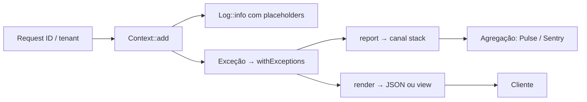

# Logs e tratamento de erros — Laravel 13.x

> **Versão:** Laravel 13.x · PHP 8.3–8.5. Base: `config/logging.php` do skeleton e
> documentação oficial de logging e error handling.

---

## 1. Canais, stacks e níveis

O canal padrão é `stack` via `LOG_CHANNEL`
(`samples/samples-config-logging.php:21`). Um stack agrega vários canais
(`samples/doc-logging.md:35`); cada canal grava conforme seu `level`, do mais grave
(`emergency`) ao menos grave (`debug`) segundo RFC 5424
(`samples/doc-logging.md:167-181`).

samples/samples-config-logging.php:55-59
```php
        'stack' => [
            'driver' => 'stack',
            'channels' => explode(',', (string) env('LOG_STACK', 'single')),
            'ignore_exceptions' => false,
        ],
```

Drivers disponíveis: `single`, `daily`, `monthly`, `slack`, `syslog`, `errorlog`,
`monolog`, `custom`, `stack` (`samples/samples-config-logging.php:48-49`). O canal
`daily` usa `max_files` com default 14 dias controlado por `LOG_DAILY_DAYS`
(`samples/samples-config-logging.php:68-74`); `monthly` mantém 3
(`samples/samples-config-logging.php:76-82`). `single` e `daily` usam
`replace_placeholders => true`, permitindo `Log::info('... {id}', ['id' => $id])`
(`samples/samples-config-logging.php:61-73`, `samples/doc-logging.md:219`).

```php
Log::info('Showing the user profile for user: {id}', ['id' => $id]);
```

Produção recomendada: `LOG_LEVEL=info` ou `warning`, `LOG_STACK=stack` com `daily`
+ canal externo (Slack/Sentry via `monolog`); `LOG_DEPRECATIONS_CHANNEL` apontando para
um canal dedicated em vez de `null` (`samples/samples-config-logging.php:34-37`).
Deprecations podem ter channel próprio sempre ativo declarando um canal chamado
`deprecations` (`samples/doc-logging.md:122-131`).

---

## 2. Contexto estruturado com `Context`

O helper `Context` adiciona dados a **todos** os logs da request/job atual. A
documentação cobre captura, escopo, empilhamento, recuperação, remoção e contexto
oculto (`samples/doc-context.md:106-205`, `samples/doc-context.md:260-395`).

Padrão recomendado (correlação ponta a ponta):

```php
// app/Http/Middleware/AssignRequestId.php — derivado dos APIs documentados
Context::add('request_id', $request->header('X-Request-Id') ?? (string) Str::uuid());
Context::add('tenant_id', optional($request->user())->tenant_id);
Context::add('route', $request->route()?->getName());
```

```php
// No job: herde/propague os IDs ao despachar
Context::add('job_id', $this->job?->getJobId());
Log::info('podcast.processed', ['podcast_id' => $this->podcast->id]);
```

Regras:

- `Context::hidden([...])` remove chaves sensíveis de logs
  (`samples/doc-context.md:361-394`) — use para tokens, senhas, PII.
- `Context::forget([...])` remove itens pontualmente
  (`samples/doc-context.md:338-360`).
- `Context::with([...], fn () => ...)` aplica escopo limitado
  (`samples/doc-context.md:166-204`).
- Em Octane, contexto é preservado entre requests; **sempre**重置 valores por
  request no middleware para evitar vazamento de tenant — detalhes em
  `07-performance-e-estabilidade.md`.

Laravel já inclui o ID do usuário autenticado no contexto de exceções; você pode
adicionar contexto global via `$exceptions->context(...)`
(`samples/doc-errors.md:72-84`).

---

## 3. `withExceptions` — classificação, renderização e resposta

O skeleton 13 já configura JSON para `api`, `api/*` e `expectsJson()`
(`samples/samples-bootstrap-app.php:17-21`). O restante vive em
`bootstrap/app.php` via `Exceptions`:

samples/doc-errors.md:241-248
```php
use App\Exceptions\InvalidOrderException;
use Illuminate\Http\Request;

->withExceptions(function (Exceptions $exceptions): void {
    $exceptions->render(function (InvalidOrderException $e, Request $request) {
        return response()->view('errors.invalid-order', status: 500);
    });
})
```
```

samples/doc-errors.md:43-49
```php
use App\Exceptions\InvalidOrderException;

->withExceptions(function (Exceptions $exceptions): void {
    $exceptions->report(function (InvalidOrderException $e) {
        // ...
    });
})
```php
use App\Exceptions\InvalidOrderException;

->withExceptions(function (Exceptions $exceptions): void {
    $exceptions->report(function (InvalidOrderException $e) {
        // ...
    });
})
```

When you register a custom exception reporting callback using the `report` method, Laravel will still log the exception using the default logging configuration for the application. If you wish to stop the propagation of the exception to the default logging stack, you may use the `stop` method when defining your reporting callback or return `false` from the callback:

```

API disponível e uso correto:

| Método | Função | Evidência |
|---|---|---|
| `report` | callback tipado para reporting; `->stop()` ou `return false` interrompe o stack padrão | `samples/doc-errors.md:36-68` |
| `context` | dados globais anexados a toda exceção | `samples/doc-errors.md:72-84` |
| `render` | callback que retorna `Response`; sem retorno, usa o default | `samples/doc-errors.md:234-268` |
| `shouldRenderJsonWhen` | decide HTML vs JSON (já no skeleton) | `samples/doc-errors.md:269-288` |
| `respond` | customiza a resposta final (ex.: `419` → redirect com flash) | `samples/doc-errors.md:289-309` |
| `dontReport` / `dontRender` / `throttle` / `levels` | filtrar, limitar e definir severidade | `samples/doc-errors.md:161-233`, `samples/doc-errors.md:383-468` |

Exceções podem implementar `report()` / `render()` / `context()` para encapsular o
comportamento na classe (`samples/doc-errors.md:310-382`). Use isso para erros de
domínio; use `withExceptions` para políticas cross-cutting.

> **Nunca** retorne detalhes de stack trace em produção. `APP_DEBUG=false` e
> `respond()` para padronizar corpo de erro (`samples/samples-env.example:1-5`).

---

## 4. Fluxo recomendado de observabilidade



1. **Gere um correlation ID** no middleware e propague para jobs e chamadas HTTP
   externas (`X-Request-Id`).
2. **Logue eventos de negócio**, não cada linha de código; use níveis coerentes.
3. **Anexe contexto** por middleware/provider, nunca dentro de cada `Log::`.
4. **Reporte exceções esperadas** com `throttle()` e `dontReport()` para evitar
   inundação (`samples/doc-errors.md:383-468`).
5. **Páginas de erro customizadas** em `resources/views/errors/` com fallback
   (`samples/doc-errors.md:478-497`).

---

## 5. Pail em desenvolvimento

`laravel/pail` faz parte do require-dev do skeleton (`samples/samples-composer.json:16`).
Ele «taila» logs em tempo real (`samples/doc-logging.md:512-556`) com filtros
`--filter`, `--message`, `--level`, `--user` (`samples/doc-logging.md:556-592`).

```bash
php artisan pail --level=warning --filter="payment"
```

Em produção, use o canal `stack` + agregador externo; Pail é ferramenta de
desenvolvimento, não backend de logging.

## Resumo de Pontos-Chave

- **`LOG_STACK` separado por vírgula** define os canais do stack; níveis filtram por canal.
- **`Log::info('... {id}', [...])`** com `replace_placeholders` evita concatenação.
- **`Context` correlaciona request → job → erro**; esconda PII com `Context::hidden`.
- **`withExceptions` centraliza report/render/respond**; skeleton já renderiza JSON em API.
- **`report()->stop()`/`return false`** controla propagação ao stack padrão.
- **Pail é para dev**; produção usa stack + agregador externo.
- **Octane exige limpar contexto por request** para não vazar dados entre usuários.
