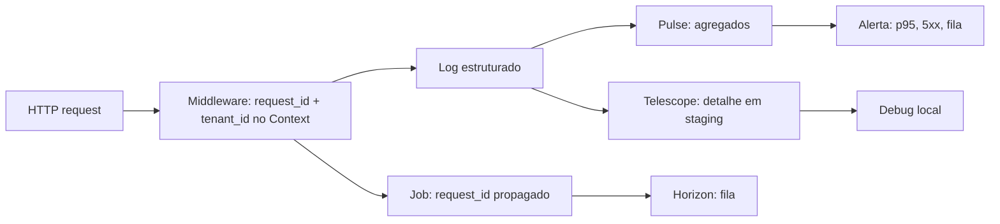

# Telemetria e instrumentação — Laravel 13.x

> **Versão:** Laravel 13.x · PHP 8.3–8.5. Escopo: Pulse (SLIs agregados), Telescope
> (diagnóstico local/staging), Horizon (filas) e correlação com logs/erros.

---

## 1. Escolha da ferramenta certa

| Ferramenta | Pergunta que responde | Onde usar | Custo |
|---|---|---|---|
| Pulse | " Como está a aplicação agora? " (requests lentos, exceções, filas, cache, queries) | produção, agregado | baixo; gravação assíncrona |
| Telescope | " Por que este request/job falhou? " (queries, eventos, mail, gate, HTTP client) | local/staging; produção só com auth rígida | alto; retenção limitada |
| Horizon | " Como estão as filas? " (throughput, falhas, tempo, workers) | produção com Redis | médio |
| Logs `Context` | correlação por request/tenant/job | todos os ambientes | baixo |

Pulse traz cards para **Servers, Application Usage, Exceptions, Queues, Slow Requests,
Slow Jobs, Slow Queries, Slow Outgoing Requests e Cache**
(`samples/doc-pulse.md:176-257`). Telescope registra watchers de Cache, Command,
Event, Exception, Gate, HTTP Client, Job, Log, Mail, Model, Notification, Query,
Redis, Request e outros (`samples/doc-telescope.md:301-467`).

---

## 2. Pulse — instalação, autorização e recortes

Instale com `composer require laravel/pulse` e publique config/migrations; o dashboard
fica em `/pulse` (`samples/doc-pulse.md:33-61`). Autorização é feita via gate `viewPulse`
no `AppServiceProvider::boot()` (`samples/doc-pulse.md:85-106`). Em produção, **nunca**
deixe o dashboard sem gate.

Recorders capturam entradas customizadas: `CacheInteractions`, `Exceptions`, `Queues`,
`SlowJobs`, `SlowOutgoingRequests`, `SlowQueries`, `SlowRequests`, `Servers`,
`UserJobs`, `UserRequests` (`samples/doc-pulse.md:257-436`). Use `Pulse::record(...)`
para métricas de negócio (ex.: checkout por tenant), mantendo cardinalidade baixa —
rótulos de alta cardinalidade (user ID, request ID) não pertencem a métricas agregadas.

SLIs mínimos para um serviço Laravel em produção:

1. **Disponibilidade:** taxa de `5xx` por rota (Pulse Exceptions + logs renderizados).
2. **Latência:** p95 de requests e jobs (Pulse Slow Requests/Slow Jobs).
3. **Saturação:** profundidade de fila e workers ocupados (Horizon + Pulse Queues).
4. **Erros de dependência:** taxa de falha do HTTP client e do DB (Pulse + Telescope em staging).
5. **Cache:** hit ratio e evictions (Pulse Cache card).

---

## 3. Telescope — diagnóstico sem vazar dados

Telescope pode ser instalado apenas em local (`--local`) para evitar exposição
(`samples/doc-telescope.md:62-101`). A configuração cobre CSP nonce
(`samples/doc-telescope.md:113-141`), **pruning** de dados antigos
(`samples/doc-telescope.md:142-160`) e autorização do dashboard
(`samples/doc-telescope.md:161-186`).

Filtros por entrada e por batch evitam ruído
(`samples/doc-telescope.md:213-275`); tagging permite agrupar requests de um mesmo
tenant/fluxo (`samples/doc-telescope.md:276-300`).

> Regras de segurança para Telescope: (1) dashboard protegido por gate; (2) `prune()`
> habilitado; (3) não habilitar watchers de `Dump`/`Gate` em produção sem necessidade;
> (4) masking de dados sensíveis em `Telescope::filter` — tokens e PII não devem ser
> gravados.

---

## 4. Horizon — saúde das filas

Horizon fornece dashboard, supervisores e métricas para filas Redis. Em produção,
proteja o dashboard com middleware de autenticação e mantenha `HORIZON_PREFIX`
isolado por ambiente. Métricas a observar: throughput, tempo médio, falhas, jobs
pendentes e workers por fila — necrotate com `08-cache-e-filas.md` para flags do worker.

Eventos que mudaram no 13 e afetam instrumentação de filas:

- `Illuminate\Queue\Events\JobAttempted`: `$exceptionOccurred` (bool) foi substituído
  por `$exception` (Exception|null) (`samples/doc-upgrade-13.md:311-326`).
- `Illuminate\Queue\Events\QueueBusy`: `$connection` → `$connectionName`
  (`samples/doc-upgrade-13.md:328-335`).

Atualize listeners, dashboards e alertas que consomem essas propriedades.

---

## 5. Correlação ponta a ponta (padrão recomendado)



Implementação mínima:

```php
// Middleware (derivado dos APIs Context documentados em samples/doc-context.md)
Context::add('request_id', $request->header('X-Request-Id') ?? (string) Str::uuid());
Context::add('tenant_id', $request->user()?->tenant_id);
```

```php
// Listener de JobAttempted (13+) — assinatura observada em samples/doc-upgrade-13.md
public function handle(JobAttempted $event): void
{
    if ($event->exception !== null) {
        Log::error('job.failed', ['connection' => $event->connectionName]);
    }
}
```

> **Cuidado:** atributos de alto cardenalidade (request ID, user ID) devem estar em
> logs/traços, não em métricas agregadas do Pulse. Use `Context::hidden()` para PII.

---

## 6. Instrumentação de código de domínio

Escolha um número pequeno e estável de eventos de negócio e meça **duração + outcome**:

```php
// derivado: padrão de medição com Carbon/Cache documentados
$started = microtime(true);
try {
    $result = $this->gateway->charge($payment);
    Pulse::record('business.charges', 'success', 1);
    return $result;
} catch (Throwable $e) {
    Pulse::record('business.charges', 'failure', 1);
    report($e); // report helper: samples/doc-errors.md:113-131
    throw $e;
} finally {
    Log::info('charge.latency', ['ms' => (microtime(true) - $started) * 1000]);
}
```

Custo controlado: evite gravar um ponto Pulse por linha; agregue por operação e por
classe de erro. Em Octane, não acumule arrays de métricas em singletons — use storage
compartilhado ou envio imediato.

## Resumo de Pontos-Chave

- **Pulse = agregados de produção; Telescope = detalhe de request; Horizon = filas.**
- **Proteja os dashboards** com gate/auth e mantenha pruning/TLS.
- **`JobAttempted::$exception` e `QueueBusy::$connectionName`** são as novas propriedades no 13.
- **Correlacione request → job → log → erro** com `request_id` no `Context`.
- **Métricas de baixa cardinalidade; logs de alta cardinalidade.**
- **Nunca logue tokens/PII**: `Context::hidden` + filtros do Telescope.
- **Octane + singletons de métrica** são fonte clássica de vazamento entre requests.
